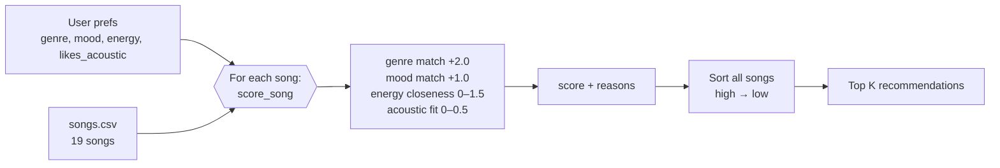

# 🎵 Music Recommender Simulation

## Project Summary

In this project you will build and explain a small music recommender system.

Your goal is to:

- Represent songs and a user "taste profile" as data
- Design a scoring rule that turns that data into recommendations
- Evaluate what your system gets right and wrong
- Reflect on how this mirrors real world AI recommenders

My version is called **VibeMatch 1.0**. It's a small content-based recommender that takes a listener's favorite genre, favorite mood, target energy, and whether they like acoustic music, then scores all 19 songs in my catalog and gives back the top 5 with a reason for every point. Run it with `python -m src.main` and it prints a results table for six different listener profiles, including a few weird ones I made on purpose to try to break it. Add `--diverse` to turn on a penalty for repeat artists and genres, or `--experiment` to run my weight-shift test.

---

## How The System Works

Real-world recommenders like Spotify or YouTube mix two big ideas. **Collaborative filtering** looks at behavior across millions of users ("people who liked what you liked also played this"), while **content-based filtering** looks at the properties of the items themselves (genre, tempo, how acoustic a track sounds) and finds songs similar to what you already enjoy. At scale these systems learn from implicit signals such as skips, replays, and playlist adds, and they rank huge catalogs in stages: a fast filter narrows millions of tracks to a few hundred candidates, and a heavier model orders them. My simulation is a small, transparent **content-based** recommender. It has no other users to learn from, so it relies only on song attributes and an explicit taste profile. It prioritizes **vibe over exact category**: genre and mood give a strong starting signal, but numeric features like energy decide which of the matching songs actually *feel* right, and every score comes with a human-readable reason.

### Features used

**`Song`**
- `genre` (categorical, e.g. pop, lofi, rock)
- `mood` (categorical, e.g. happy, chill, intense)
- `energy` (0.0–1.0, how intense or active the track feels)
- `acousticness` (0.0–1.0, acoustic vs. electronic/produced sound)
- `valence` (0.0–1.0, musical positivity), used as a light tie-breaker
- `tempo_bpm` and `danceability` are loaded but weighted lightly or not at all, since in this dataset tempo mostly tracks energy and would double-count it
- `id`, `title`, `artist` for display only

**`UserProfile`**
- `favorite_genre`
- `favorite_mood`
- `target_energy` (0.0–1.0)
- `likes_acoustic` (True/False)

### Algorithm Recipe

**Scoring Rule (one song):**

| Signal | Points |
|---|---|
| Genre matches `favorite_genre` | +2.0 |
| Mood matches `favorite_mood` | +1.0 |
| Energy closeness: `1.5 × (1 − abs(song.energy − target_energy))` | 0 – 1.5 |
| Acoustic fit: `acousticness` if `likes_acoustic`, else `1 − acousticness`, × 0.5 | 0 – 0.5 |

Energy uses *closeness*, not raw value. A user who wants 0.4 energy should be rewarded for a 0.42 song and penalized for a 0.93 song, so the score is based on the distance `|song − target|` flipped so that a smaller distance gives more points. Genre is worth more than mood because genre describes the overall sound palette, while mood labels are broader and shared across genres (a "chill" ambient track and a "chill" lofi track can still sound very different).

**Ranking Rule (the list):** score every song in the catalog, sort from highest to lowest score, and return the top `k`. The scoring rule only says how well *one* song fits. The ranking rule turns those independent numbers into a decision about *which* songs to show and in what order, and it is also where you would later add things like diversity rules (e.g., no more than two songs by the same artist).

### Catalog

The starter catalog of 10 songs was expanded to 19 with genres and moods that were missing: hip-hop/confident, classical/peaceful, country/nostalgic, metal/angry, r&b/romantic, edm/energetic, folk/melancholic, reggae/relaxed, and blues/sad. The new songs cover the extremes too, from very low energy (0.15) to very high (0.97), so energy closeness has a wider range to separate songs.

### Taste profile

```python
user_prefs = {
    "genre": "lofi",
    "mood": "chill",
    "energy": 0.40,
    "likes_acoustic": True,
}
```

**Can it tell "intense rock" from "chill lofi"?** Yes, easily. A dry run of the recipe scores Library Rain (lofi/chill) at **4.85** and Storm Runner (rock/intense) at **0.79**. Genre, mood, energy, and acousticness all point the same way, so the gap is large. The profile *is* narrow, though: only 3 songs are lofi, so after them the ranking is decided almost entirely by energy and acousticness. A blues/sad song (1.79) lands right next to a jazz/relaxed one (1.90), because the system has no idea that "sad" is further from "chill" than "relaxed" is.

### Data flow



### Expected biases and limitations

- **Genre over-priority.** A genre match (+2.0) is worth more than a perfect mood *and* energy match combined for some songs, so a great ambient/chill track can lose to a mediocre lofi track with the wrong mood.
- **Exact string matching.** "indie pop" gets no genre credit from a "pop" fan, and "relaxed" gets no mood credit from a "chill" listener, even though they are close in feel.
- **Moods are all-or-nothing.** Every non-matching mood scores 0, so "sad" and "relaxed" are treated as equally far from "chill."
- **Tiny, hand-picked catalog.** Most genres have only one song, so a user whose favorite genre is metal gets exactly one genre match, and the rest of their list is filled by energy alone.
- **Filter bubble.** The system only recommends more of what the profile already says, and it never surprises the user with something new.

---

## Getting Started

### Setup

1. Create a virtual environment (optional but recommended):

   ```bash
   python -m venv .venv
   source .venv/bin/activate      # Mac or Linux
   .venv\Scripts\activate         # Windows

2. Install dependencies

```bash
pip install -r requirements.txt
```

3. Run the app:

```bash
python -m src.main
```

### Running Tests

Run the starter tests with:

```bash
pytest
```

You can add more tests in `tests/test_recommender.py`.

---

## Sample Recommendation Output

Output of `python -m src.main` for the default pop/happy profile and the lofi/chill profile (all six profiles are in the [model card](model_card.md#7-evaluation)):

```
=== High-Energy Pop ===  {'genre': 'pop', 'mood': 'happy', 'energy': 0.8}
+-----+------------------------+------------------+------------------------+--------+------------------------------------------+
| #   | Title                  | Artist           | Genre / Mood           | Score  | Reasons                                  |
+=====+========================+==================+========================+========+==========================================+
| 1   | Sunrise City           | Neon Echo        | pop / happy            | 4.47   | genre match (+2.0)                       |
|     |                        |                  |                        |        | mood match (+1.0)                        |
|     |                        |                  |                        |        | energy 0.82 vs target 0.80 (+1.47)       |
+-----+------------------------+------------------+------------------------+--------+------------------------------------------+
| 2   | Gym Hero               | Max Pulse        | pop / intense          | 3.30   | genre match (+2.0)                       |
|     |                        |                  |                        |        | energy 0.93 vs target 0.80 (+1.30)       |
+-----+------------------------+------------------+------------------------+--------+------------------------------------------+
| 3   | Rooftop Lights         | Indigo Parade    | indie pop / happy      | 2.44   | mood match (+1.0)                        |
|     |                        |                  |                        |        | energy 0.76 vs target 0.80 (+1.44)       |
+-----+------------------------+------------------+------------------------+--------+------------------------------------------+
| 4   | Concrete Crown         | Verse Theory     | hip-hop / confident    | 1.47   | energy 0.78 vs target 0.80 (+1.47)       |
+-----+------------------------+------------------+------------------------+--------+------------------------------------------+
| 5   | Night Drive Loop       | Neon Echo        | synthwave / moody      | 1.42   | energy 0.75 vs target 0.80 (+1.42)       |
+-----+------------------------+------------------+------------------------+--------+------------------------------------------+

=== Chill Lofi ===  {'genre': 'lofi', 'mood': 'chill', 'energy': 0.4, 'likes_acoustic': True}
+-----+------------------------+------------------+------------------------+--------+------------------------------------------+
| #   | Title                  | Artist           | Genre / Mood           | Score  | Reasons                                  |
+=====+========================+==================+========================+========+==========================================+
| 1   | Library Rain           | Paper Lanterns   | lofi / chill           | 4.85   | genre match (+2.0)                       |
|     |                        |                  |                        |        | mood match (+1.0)                        |
|     |                        |                  |                        |        | energy 0.35 vs target 0.40 (+1.42)       |
|     |                        |                  |                        |        | acoustic fit (+0.43)                     |
+-----+------------------------+------------------+------------------------+--------+------------------------------------------+
| 2   | Midnight Coding        | LoRoom           | lofi / chill           | 4.82   | genre match (+2.0)                       |
|     |                        |                  |                        |        | mood match (+1.0)                        |
|     |                        |                  |                        |        | energy 0.42 vs target 0.40 (+1.47)       |
|     |                        |                  |                        |        | acoustic fit (+0.35)                     |
+-----+------------------------+------------------+------------------------+--------+------------------------------------------+
| 3   | Focus Flow             | LoRoom           | lofi / focused         | 3.89   | genre match (+2.0)                       |
|     |                        |                  |                        |        | energy 0.40 vs target 0.40 (+1.50)       |
|     |                        |                  |                        |        | acoustic fit (+0.39)                     |
+-----+------------------------+------------------+------------------------+--------+------------------------------------------+
| 4   | Spacewalk Thoughts     | Orbit Bloom      | ambient / chill        | 2.78   | mood match (+1.0)                        |
|     |                        |                  |                        |        | energy 0.28 vs target 0.40 (+1.32)       |
|     |                        |                  |                        |        | acoustic fit (+0.46)                     |
+-----+------------------------+------------------+------------------------+--------+------------------------------------------+
| 5   | Coffee Shop Stories    | Slow Stereo      | jazz / relaxed         | 1.90   | energy 0.37 vs target 0.40 (+1.46)       |
|     |                        |                  |                        |        | acoustic fit (+0.45)                     |
+-----+------------------------+------------------+------------------------+--------+------------------------------------------+
```

**Screenshot or video** *(optional)*: <!-- Insert a screenshot or demo video link here -->

---

## Experiments You Tried

- **Six different listeners.** I tested three normal profiles (High-Energy Pop, Chill Lofi, Deep Intense Rock) and three tricky ones: someone who wants sad music at 0.9 energy, someone whose favorite genre (K-pop) isn't in the catalog, and someone with an energy target of 1.5, which is off the 0 to 1 scale. The normal ones felt right to me. Library Rain and Midnight Coding are exactly what I'd put on for late-night studying, and Storm Runner topping the rock list makes sense.
- **Halving genre, doubling energy.** I changed the genre weight from 2.0 to 1.0 and the energy weight from 1.5 to 3.0 (`python -m src.main --experiment`). For the pop/happy listener it actually got better, because Rooftop Lights (happy) moved above Gym Hero (intense). For lofi and rock it barely changed anything. For the 1.5 energy listener it got worse, and the only classical song dropped out completely.
- **Gym Hero everywhere.** Gym Hero showed up in four of my six lists. It's labeled pop and it's super high energy, so it keeps collecting points even for people who just want happy pop.
- **Diversity penalty.** I added a `--diverse` mode that takes 1 point off a song if its artist is already in the list and 0.5 off if its genre is. For lofi it pushed Spacewalk Thoughts above a second LoRoom song, and for pop it swapped out a second Neon Echo song. It doesn't stop Gym Hero from showing up across different people's lists though, only repeats inside one list.
- **Tempo and valence.** I left these out of the score on purpose. In this dataset tempo pretty much moves with energy, so adding it would just count energy twice.

Full outputs and comparisons are in the [model card](model_card.md#7-evaluation).

---

## Limitations and Risks

- The catalog is tiny (19 songs) and most genres only have one song, so a metal or blues fan gets one real match and then filler.
- Genre and mood only count if the words match exactly. "indie pop" gets nothing from a pop fan, and "relaxed" gets nothing from someone who wants "chill."
- The genre bonus can beat songs that actually feel closer, which is why Gym Hero keeps showing up.
- It has no way to say "nothing really fits." For the sad but high-energy listener it gave one slow blues song and then four loud workout songs.
- It doesn't check input. An energy target of 1.5 gave a negative energy score.
- It doesn't understand lyrics, language, or what the music actually sounds like. The numbers are made up.
- It only recommends more of what you already said you like, so it's a filter bubble by design.

More detail is in the [model card](model_card.md#6-limitations-and-bias).

---

## Reflection

Read the full write-up in the [**Model Card**](model_card.md).

The biggest thing I learned is that a recommender is really just a way to turn data into a number and then sort by it. My whole system is four rules and a sort, but the lofi results genuinely felt like a playlist someone made for me. That made it click that apps like Spotify feel smart partly because ranking anything with confidence feels smart, even when the system doesn't know what the music sounds like.

It also showed me how easily bias sneaks in. I picked the weights, I made up the songs, and I decided that exact genre labels matter most, and every one of those choices shaped who gets good recommendations. Someone whose taste fits the catalog (pop, lofi, rock) gets great results, while someone who likes K-pop, or wants something sad but energetic, gets leftovers with scores that still look confident. In a real app with millions of users, those same kinds of choices could decide which artists get heard and which never show up.
