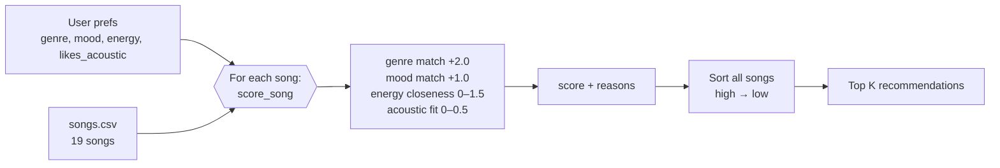

# 🎵 Music Recommender Simulation

## Project Summary

In this project you will build and explain a small music recommender system.

Your goal is to:

- Represent songs and a user "taste profile" as data
- Design a scoring rule that turns that data into recommendations
- Evaluate what your system gets right and wrong
- Reflect on how this mirrors real world AI recommenders

Replace this paragraph with your own summary of what your version does.

---

## How The System Works

Real-world recommenders like Spotify or YouTube mix two big ideas. **Collaborative filtering** looks at behavior across millions of users ("people who liked what you liked also played this"), while **content-based filtering** looks at the properties of the items themselves (genre, tempo, how acoustic a track sounds) and finds songs similar to what you already enjoy. At scale these systems learn from implicit signals such as skips, replays, and playlist adds, and they rank huge catalogs in stages: a fast filter narrows millions of tracks to a few hundred candidates, and a heavier model orders them. My simulation is a small, transparent **content-based** recommender. It has no other users to learn from, so it relies only on song attributes and an explicit taste profile. It prioritizes **vibe over exact category**: genre and mood give a strong starting signal, but numeric features like energy decide which of the matching songs actually *feel* right, and every score comes with a human-readable reason.

### Features used

**`Song`**
- `genre` (categorical, e.g. pop, lofi, rock)
- `mood` (categorical, e.g. happy, chill, intense)
- `energy` (0.0–1.0, how intense or active the track feels)
- `acousticness` (0.0–1.0, acoustic vs. electronic/produced sound)
- `valence` (0.0–1.0, musical positivity), used as a light tie-breaker
- `tempo_bpm` and `danceability` are loaded but weighted lightly or not at all, since in this dataset tempo mostly tracks energy and would double-count it
- `id`, `title`, `artist` for display only

**`UserProfile`**
- `favorite_genre`
- `favorite_mood`
- `target_energy` (0.0–1.0)
- `likes_acoustic` (True/False)

### Algorithm Recipe

**Scoring Rule (one song):**

| Signal | Points |
|---|---|
| Genre matches `favorite_genre` | +2.0 |
| Mood matches `favorite_mood` | +1.0 |
| Energy closeness: `1.5 × (1 − abs(song.energy − target_energy))` | 0 – 1.5 |
| Acoustic fit: `acousticness` if `likes_acoustic`, else `1 − acousticness`, × 0.5 | 0 – 0.5 |

Energy uses *closeness*, not raw value. A user who wants 0.4 energy should be rewarded for a 0.42 song and penalized for a 0.93 song, so the score is based on the distance `|song − target|` flipped so that a smaller distance gives more points. Genre is worth more than mood because genre describes the overall sound palette, while mood labels are broader and shared across genres (a "chill" ambient track and a "chill" lofi track can still sound very different).

**Ranking Rule (the list):** score every song in the catalog, sort from highest to lowest score, and return the top `k`. The scoring rule only says how well *one* song fits. The ranking rule turns those independent numbers into a decision about *which* songs to show and in what order, and it is also where you would later add things like diversity rules (e.g., no more than two songs by the same artist).

### Catalog

The starter catalog of 10 songs was expanded to 19 with genres and moods that were missing: hip-hop/confident, classical/peaceful, country/nostalgic, metal/angry, r&b/romantic, edm/energetic, folk/melancholic, reggae/relaxed, and blues/sad. The new songs cover the extremes too, from very low energy (0.15) to very high (0.97), so energy closeness has a wider range to separate songs.

### Taste profile

```python
user_prefs = {
    "genre": "lofi",
    "mood": "chill",
    "energy": 0.40,
    "likes_acoustic": True,
}
```

**Can it tell "intense rock" from "chill lofi"?** Yes, easily. A dry run of the recipe scores Library Rain (lofi/chill) at **4.85** and Storm Runner (rock/intense) at **0.79**. Genre, mood, energy, and acousticness all point the same way, so the gap is large. The profile *is* narrow, though: only 3 songs are lofi, so after them the ranking is decided almost entirely by energy and acousticness. A blues/sad song (1.79) lands right next to a jazz/relaxed one (1.90), because the system has no idea that "sad" is further from "chill" than "relaxed" is.

### Data flow



### Expected biases and limitations

- **Genre over-priority.** A genre match (+2.0) is worth more than a perfect mood *and* energy match combined for some songs, so a great ambient/chill track can lose to a mediocre lofi track with the wrong mood.
- **Exact string matching.** "indie pop" gets no genre credit from a "pop" fan, and "relaxed" gets no mood credit from a "chill" listener, even though they are close in feel.
- **Moods are all-or-nothing.** Every non-matching mood scores 0, so "sad" and "relaxed" are treated as equally far from "chill."
- **Tiny, hand-picked catalog.** Most genres have only one song, so a user whose favorite genre is metal gets exactly one genre match, and the rest of their list is filled by energy alone.
- **Filter bubble.** The system only recommends more of what the profile already says, and it never surprises the user with something new.

---

## Getting Started

### Setup

1. Create a virtual environment (optional but recommended):

   ```bash
   python -m venv .venv
   source .venv/bin/activate      # Mac or Linux
   .venv\Scripts\activate         # Windows

2. Install dependencies

```bash
pip install -r requirements.txt
```

3. Run the app:

```bash
python -m src.main
```

### Running Tests

Run the starter tests with:

```bash
pytest
```

You can add more tests in `tests/test_recommender.py`.

---

## Sample Recommendation Output

Paste a sample of your recommender's output here as a text block so a reader can see what it produces:

```
# e.g.:
# User profile: genre=indie, mood=chill, energy=low
# Recommendations:
#   1. ...
#   2. ...
#   3. ...
```

**Screenshot or video** *(optional)*: <!-- Insert a screenshot or demo video link here -->

---

## Experiments You Tried

Use this section to document the experiments you ran. For example:

- What happened when you changed the weight on genre from 2.0 to 0.5
- What happened when you added tempo or valence to the score
- How did your system behave for different types of users

---

## Limitations and Risks

Summarize some limitations of your recommender.

Examples:

- It only works on a tiny catalog
- It does not understand lyrics or language
- It might over favor one genre or mood

You will go deeper on this in your model card.

---

## Reflection

Read and complete `model_card.md`:

[**Model Card**](model_card.md)

Write 1 to 2 paragraphs here about what you learned:

- about how recommenders turn data into predictions
- about where bias or unfairness could show up in systems like this


